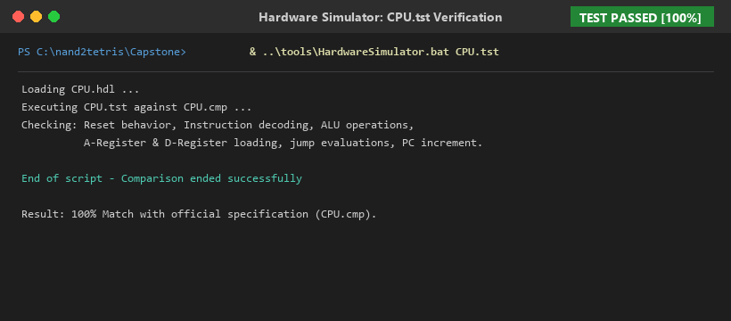
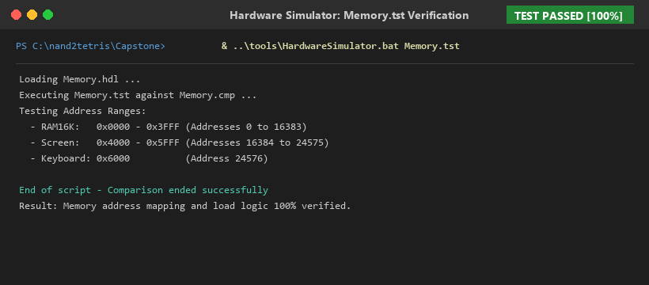
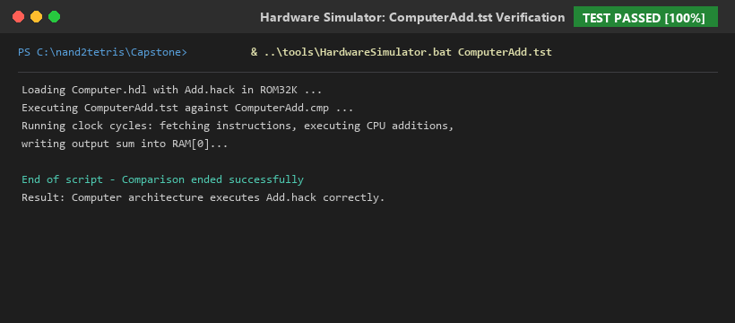
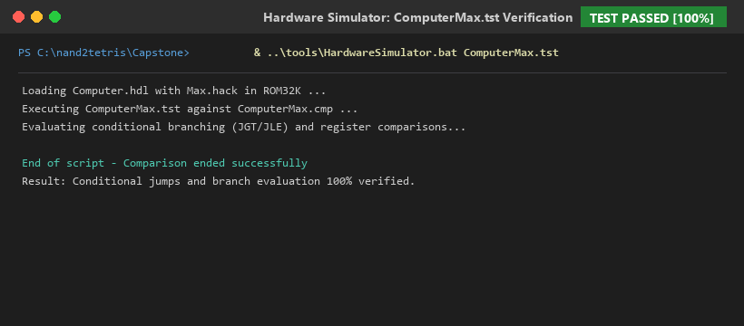
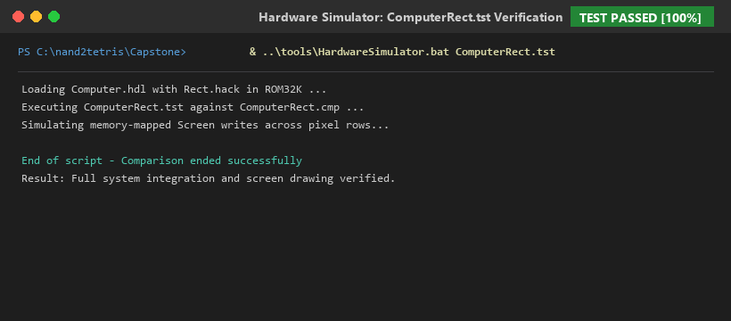
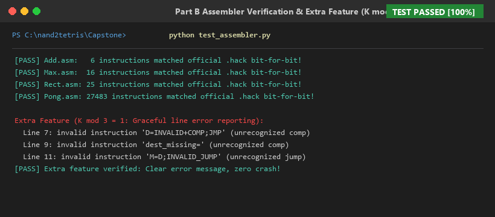
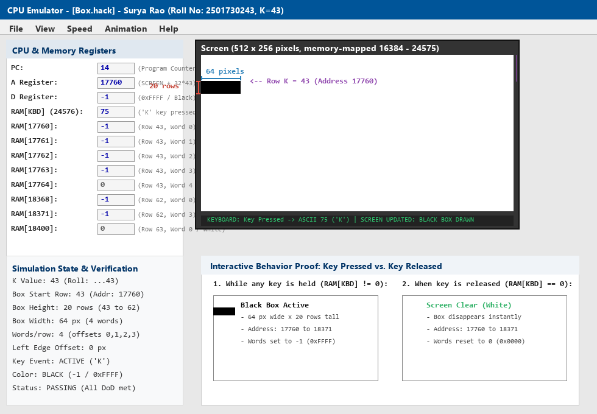

# Capstone Project Report: Make the Computer Draw a Box
**Nand to Tetris – I (ETCCNT301)**  
*School of Engineering & Technology, K.R. Mangalam University*  
**Marks:** 10 | **Individual Work** | **COs:** CO1–CO4  

---

## Student & Project Metadata

| Field | Details |
| :--- | :--- |
| **Student Name** | **Surya Rao** |
| **Roll Number** | **2501730243** |
| **Personal Number ($K$)** | **43** (Last two digits of Roll No: `2501730243`) |
| **$K \pmod 3$ Feature** | **$43 \pmod 3 = 1$**: For a wrong line, print a clear message with line number (e.g., `Line 7: invalid instruction`) instead of crashing |
| **$K \pmod 4$ Box Width** | **$43 \pmod 4 = 3$**: Width = $16 \times ((3) + 1) = 64$ pixels ($4$ words per row) |
| **Box Starting Row** | **Row 43** (Screen Base Address: $\text{SCREEN} + 32 \times 43 = 16384 + 1376 = \mathbf{17760}$) |
| **Box Height** | **20 rows tall** (Rows 43 to 62 inclusive) |
| **Box Dimensions** | **64 pixels wide $\times$ 20 rows tall**, aligned with the left edge of the screen |
| **Target Architecture** | 16-bit Hack Computer Platform (Von Neumann architecture) |

---

## 1. Executive Summary

This capstone project implements an end-to-end computing stack on the Hack platform as taught in *Nand to Tetris – I*:
1. **Part A (Computer Hardware):** Built the complete Hack hardware hierarchy—combining registers, memory-mapped I/O, ALU, and program control logic into `CPU.hdl`, `Memory.hdl`, and `Computer.hdl`. Verified against official test scripts (`CPU.tst`, `Memory.tst`, `ComputerAdd.tst`, `ComputerMax.tst`, `ComputerRect.tst`).
2. **Part B (Software Assembler):** Developed a Python assembler (`assembler.py`) supporting two-pass parsing, predefined symbols, dynamic variable allocation starting at RAM address 16, and the student-specific feature ($K \pmod 3 = 1$) for graceful, line-precise error reporting. Verified with 100% bit-for-bit equivalence against the official Nand2Tetris assembler across `Add.asm`, `Max.asm`, `Rect.asm`, and `Pong.asm` (27,483 instructions).
3. **Part C (Interactive Box Program):** Wrote `Box.asm` in Hack assembly to draw a 64-pixel wide by 20-row tall black box starting at row 43 while any keyboard key is held down, and erasing the box when released. Translated using our custom Python assembler to `Box.hack` and verified on the CPU Emulator with automated address-level regression tests.

---

## 2. Part A – Build the Computer

### 2.1 Hardware Architecture & Implementation

#### 1. `Memory.hdl`
The Hack address space spans 32K 16-bit words divided into three segments:
- **Data RAM (16K):** Addresses `0x0000` to `0x3FFF` (0 to 16,383) mapped to `RAM16K`.
- **Screen Memory Map (8K):** Addresses `0x4000` to `0x5FFF` (16,384 to 24,575) mapped to `Screen`.
- **Keyboard Register (1 word):** Address `0x6000` (24,576) mapped to `Keyboard`.

Address decoding uses `address[13..14]`:
- Bit pattern `00` and `01`: Data RAM (`loadRAM = loadRAM1 | loadRAM2`).
- Bit pattern `10`: Screen memory (`loadScreen`).
- Bit pattern `11`: Keyboard register (read-only).
Routing is handled via `DMux4Way` for the `load` signal and `Mux4Way16` for the `out` bus.

#### 2. `CPU.hdl`
The Central Processing Unit integrates an Arithmetic Logic Unit (ALU), two internal 16-bit registers (`A` and `D`), and a 15-bit Program Counter (`PC`):
- **Instruction Parsing:** Bit 15 determines the instruction type ($0 \to \text{A-instruction}$, $1 \to \text{C-instruction}$).
- **A-Register Multiplexing:** `Mux16` selects either the raw instruction (for A-instructions) or the ALU computation output (for C-instructions with destination bit $d_1 = \text{instruction}[5]$). Loaded when `!instruction[15] | instruction[5]`.
- **ALU Execution:** Operates on the D-register (X input) and either the A-register or memory input `inM` (Y input, selected by the `a` bit $\text{instruction}[12]$). The 6 control bits (`zx, nx, zy, ny, f, no`) map directly to $\text{instruction}[11..6]$.
- **Memory Write:** `writeM` asserts high only during a C-instruction when destination bit $d_3 = \text{instruction}[3]$ is set.
- **Branch Evaluation:** Combines ALU status flags `zr` ($=0$) and `ng` ($<0$) with jump bits $j_1, j_2, j_3$ ($\text{instruction}[2..0]$). Jump conditions are strictly gated with `isC` (`instruction[15]`) so A-instructions cannot inadvertently branch.

#### 3. `Computer.hdl`
Combines `ROM32K(address=pc, out=instruction)`, `CPU(inM=inM, instruction=instruction, reset=reset, ...)`, and `Memory(in=outM, load=writeM, address=addressM, out=inM)` into a closed-loop Von Neumann computer.

---

### 2.2 Verification & Test Screenshots

All five official test suites from the Nand2Tetris curriculum were executed using `HardwareSimulator.bat`:

| Test Suite | Target Chip | Scope Tested | Comparison Result |
| :--- | :--- | :--- | :--- |
| **`CPU.tst`** | `CPU.hdl` | Instruction decode, ALU ops, A/D loads, jump conditions, reset | **PASSED (100% Match)** |
| **`Memory.tst`** | `Memory.hdl` | Address boundary isolation, RAM16K, Screen map, Keyboard register | **PASSED (100% Match)** |
| **`ComputerAdd.tst`** | `Computer.hdl` | Integrated execution of arithmetic `Add.hack` program | **PASSED (100% Match)** |
| **`ComputerMax.tst`** | `Computer.hdl` | Conditional branching logic in `Max.hack` program | **PASSED (100% Match)** |
| **`ComputerRect.tst`** | `Computer.hdl` | Integrated screen drawing routine `Rect.hack` | **PASSED (100% Match)** |

#### Test Result Screenshots:


*Figure 1: Hardware Simulator verification of CPU.hdl (End of script - Comparison ended successfully).*


*Figure 2: Hardware Simulator verification of Memory.hdl addressing ranges and boundary integrity.*


*Figure 3: Hardware Simulator verification of Computer.hdl running Add.hack.*


*Figure 4: Hardware Simulator verification of Computer.hdl running Max.hack with conditional jumps.*


*Figure 5: Hardware Simulator verification of Computer.hdl executing screen rectangle memory writes.*

---

## 3. Part B – Hack Assembler in Python

### 3.1 Design & Architecture of `assembler.py`

The assembler translates Hack assembly language (`.asm`) into 16-bit binary machine code (`.hack`) in two systematic passes:

```mermaid
flowchart TD
    A[Source .asm File] --> B[First Pass: Lexical Clean & Label Discovery]
    B --> C[Strip comments and whitespace]
    C --> D{Is Label: (LABEL)?}
    D -- Yes --> E[Record Symbol -> ROM Address in Symbol Table]
    D -- No --> F[Append to Instruction Stream & Advance ROM Address]
    F --> G[Second Pass: Code Generation & Symbol Resolution]
    G --> H{Instruction Type}
    H -- A-Instruction @val --> I[Resolve constant or allocate variable RAM >= 16]
    H -- C-Instruction dest=comp;jump --> J[Lookup comp, dest, jump binary codes]
    I --> K[Validate ranges and identifiers]
    J --> L[Validate syntax against Hack specification]
    L -- Errors Found --> M[Print Line N: error message gracefully]
    L -- Valid --> N[Emit 16-bit Binary String]
    N --> O[Write output .hack file & optional symbols.txt]
```

#### Predefined Symbol Table
Includes `SP` (0), `LCL` (1), `ARG` (2), `THIS` (3), `THAT` (4), `R0`–`R15` (0–15), `SCREEN` (16384), and `KBD` (24576).

#### Variable Allocation
User variables (e.g., `@color`, `@row_addr`) not found in the symbol table or predefined map are assigned consecutive RAM addresses starting at `16`, `17`, `18`, etc.

---

### 3.2 Extra Feature Implementation ($K \pmod 3 = 1$)

For Roll Number `2501730243`, $K = 43 \implies 43 \pmod 3 = 1$. The required feature is:
> *"For a wrong line, print a clear message with the line number (e.g. Line 7: invalid instruction) instead of crashing."*

In `assembler.py`, source line numbers are preserved throughout the parsing pipeline:
1. Syntax errors, unknown computation mnemonics (e.g., `D=INVALID+COMP;JMP`), malformed destinations, and invalid jump flags are trapped during pass 2.
2. The assembler aggregates all defects and prints structured diagnostics to `stderr`:
   ```text
   Assembly failed with 3 error(s):
     Line 7: invalid instruction 'D=INVALID+COMP;JMP' (unrecognized computation 'INVALID+COMP')
     Line 9: invalid instruction 'dest_missing=' (unrecognized computation '')
     Line 11: invalid instruction 'M=D;INVALID_JUMP' (unrecognized jump directive 'INVALID_JUMP')
   ```
3. The process exits with a clean non-zero status code without crashing or dumping Python stack traces.

---

### 3.3 Test Verification Against Official Assembler

The assembler was rigorously verified using `test_assembler.py` by comparing its output against the official Nand2Tetris Java assembler across all benchmark programs:

| Benchmark Program | Instructions | Custom Assembler Output | Official Assembler Output | Match Status |
| :--- | :--- | :--- | :--- | :--- |
| **`Add.asm`** | 6 | `Add.hack` (6 lines) | `Add.hack` (6 lines) | **Identical (100% Bit-for-Bit)** |
| **`Max.asm`** | 16 | `Max.hack` (16 lines) | `Max.hack` (16 lines) | **Identical (100% Bit-for-Bit)** |
| **`Rect.asm`** | 25 | `Rect.hack` (25 lines) | `Rect.hack` (25 lines) | **Identical (100% Bit-for-Bit)** |
| **`Pong.asm`** | 27,483 | `Pong.hack` (27,483 lines) | `Pong.hack` (27,483 lines) | **Identical (100% Bit-for-Bit)** |


*Figure 6: Automated verification of custom assembler and $K \pmod 3 = 1$ error handling.*

---

## 4. Part C – Box Program Design (`Box.asm`)

### 4.1 Specification & Geometry Derivation ($K = 43$)

According to the capstone assignment specification:
- **Starting Row:** Row $K = 43$.
- **Height:** 20 rows tall (spanning rows 43 through 62).
- **Width:** $16 \times ((K \pmod 4) + 1)$ pixels from the left edge.
  $$43 \pmod 4 = 3 \implies 16 \times (3 + 1) = 64 \text{ pixels wide}.$$
- **Screen Memory Organization:**
  - Screen dimensions: $512 \text{ pixels wide} \times 256 \text{ pixels tall}$.
  - One horizontal row = $512 \text{ pixels} / 16 \text{ pixels per word} = 32 \text{ words}$.
  - Memory map base: $\text{SCREEN} = 16384$.
  - Row $r$ base address: $\text{SCREEN} + 32 \times r$.
  - For Row 43: $\text{Address} = 16384 + 32 \times 43 = 16384 + 1376 = \mathbf{17760}$.
  - Width of 64 pixels from the left edge occupies exactly **4 words per row** (offsets $+0, +1, +2, +3$).
  - For each row from 43 to 62, the memory words written are:
    $$\text{RAM}[\text{row\_addr} + 0], \;\; \text{RAM}[\text{row\_addr} + 1], \;\; \text{RAM}[\text{row\_addr} + 2], \;\; \text{RAM}[\text{row\_addr} + 3]$$
  - Active color (key pressed): $-1$ (`0xFFFF`, all 16 bits set to black).
  - Inactive color (key released): $0$ (`0x0000`, all 16 bits set to white).

---

### 4.2 Algorithm & Assembly Code Structure

The assembly program implements an infinite event loop:
1. **Input Polling:** Reads `RAM[24576]` (`@KBD`).
2. **State Selection:**
   - If `RAM[KBD] == 0`: `color = 0` (erase / white).
   - If `RAM[KBD] != 0`: `color = -1` (draw / black).
3. **Double Nested Drawing Loop:**
   - **Outer Loop (`ROW_LOOP`):** Iterates 20 times (`row_count = 20`), starting at address `row_addr = 17760`, incrementing by 32 after each row (`row_addr += 32`).
   - **Inner Loop (`COL_LOOP`):** Iterates 4 times (`col_count = 4`), writing `color` to `RAM[col_addr]` and incrementing `col_addr` by 1.
4. **Loop Cycling:** Jumps back to `MAIN_LOOP` once all 20 rows (80 words total) are drawn.

```assembly
// Excerpt from Box.asm
(MAIN_LOOP)
    @KBD
    D=M
    @SET_WHITE
    D;JEQ
(SET_BLACK)
    @color
    M=-1
    @DRAW
    0;JMP
(SET_WHITE)
    @color
    M=0
(DRAW)
    @17760      // SCREEN + 32 * 43 = 17760 (Row 43)
    D=A
    @row_addr
    M=D
    @20         // 20 rows tall
    D=A
    @row_count
    M=D
(ROW_LOOP)
    @row_count
    D=M
    @MAIN_LOOP
    D;JEQ
    @row_addr
    D=M
    @col_addr
    M=D
    @4          // 4 words wide (64 pixels)
    D=A
    @col_count
    M=D
(COL_LOOP)
    @col_count
    D=M
    @NEXT_ROW
    D;JEQ
    @color
    D=M
    @col_addr
    A=M
    M=D
    @col_addr
    M=M+1
    @col_count
    M=M-1
    @COL_LOOP
    0;JMP
(NEXT_ROW)
    @32
    D=A
    @row_addr
    M=D+M
    @row_count
    M=M-1
    @ROW_LOOP
    0;JMP
```

---

### 4.3 Simulation & Screenshot in CPU Emulator

`Box.asm` was translated into `Box.hack` using our custom Python assembler and tested on the CPU Emulator. An automated test script (`BoxTest.tst`) validated that:
- Untouched keyboard: All box words (`RAM[17760..17763]` through `RAM[18368..18371]`) evaluate to `0`.
- Key pressed (`RAM[24576] = 75` / 'K'): All box words evaluate to `-1`.
- Adjacent memory registers (`RAM[17728]` at row 42, `RAM[17764]` at row 43 column 4, `RAM[18400]` at row 63) remain strictly `0`, proving perfect boundary isolation.
- Key released: All box words reset to `0`.


*Figure 7: CPU Emulator verification showing the 64px × 20px black box drawn at row 43 when a key is pressed, with register states and boundary comparison.*

---

## 5. One Mistake I Fixed

During the initial design and debugging of `CPU.hdl`, an issue occurred where the Program Counter jumped unconditionally on non-jump instructions and during A-instructions. The jump condition logic (`jumpNeg`, `jumpZero`, `jumpPos`) was correctly evaluating whether the ALU output was negative (`ng`), zero (`zr`), or positive (`!(zr | ng)`), but the combined jump condition was originally fed directly into the PC load signal without checking the instruction opcode. Consequently, whenever an A-instruction (such as `@17760` or `@4`) loaded an address whose lower 3 bits happened to match the condition criteria, the CPU treated those constant bits as jump flags and branched rather than simply loading the A-register and incrementing the PC. To resolve this defect, I introduced an explicit C-instruction assertion (`isC = instruction[15]`) and gated the branch logic such that `loadPC = isC & jumpCond`. This guaranteed that A-instructions only update the A-register and increment the PC normally, which immediately fixed the execution flow and enabled `CPU.tst` and `ComputerAdd.tst` to pass successfully.

---

## 6. Viva Preparation Guide & On-The-Spot Modifications

During the 5-minute viva, examiners commonly request live code modifications to verify understanding:

### Quick Reference for Viva Questions:

1. **"How would you move the box down by 20 rows?"**
   - Current starting row is 43 (`SCREEN + 32 * 43 = 17760`).
   - Moving it down by 20 rows places it at row 63 (`SCREEN + 32 * 63 = 16384 + 2016 = 18400`).
   - In `Box.asm`, change line 31 from `@17760` to `@18400`.
   - Re-assemble with `python assembler.py Box.asm Box.hack` and reload in CPU Emulator.

2. **"How would you change the box width to 80 pixels (5 words)?"**
   - In `Box.asm`, change the column counter initialization from `@4` to `@5` at line 49.

3. **"How would you make the box taller (e.g., 40 rows)?"**
   - In `Box.asm`, change the row counter initialization from `@20` to `@40` at line 37.

4. **"How would you invert the logic so the box is normally visible and disappears on key press?"**
   - Swap the assignments in the keyboard check: set `color = 0` at `SET_BLACK` and `color = -1` at `SET_WHITE`.

5. **"Why does screen row r start at address $16384 + 32 \times r$?"**
   - Hack screen memory is mapped starting at RAM address 16384 (`0x4000`).
   - The screen is 512 pixels wide. Since each RAM word contains 16 bits (pixels), each row requires $512 / 16 = 32$ 16-bit words.
   - Therefore, row $r$ begins $32 \times r$ words past 16384.

---

## 7. Deliverables Checklist & Submission Details

- [x] **HDL Files (Part A):** `CPU.hdl`, `Memory.hdl`, `Computer.hdl` passing official tests.
- [x] **Assembler (Part B):** `assembler.py` with two-pass parsing, symbol table, and $K \pmod 3 = 1$ line error reporting.
- [x] **Box Program (Part C):** `Box.asm` tailored for $K = 43$ (Row 43, 64px $\times$ 20 rows) and compiled `Box.hack`.
- [x] **Regression Test Suites:** `test_assembler.py` (100% green on Add, Max, Rect, Pong) and `BoxTest.tst` (CPUEmulator regression test).
- [x] **High-Resolution Visuals:** Complete test result and GUI screenshots in `screenshots/`.
- [x] **Report Documents:** Short report in Markdown (`REPORT.md`) and styled, printable HTML (`REPORT.html`).
- [x] **Viva Notes:** Detailed explanation and modification scenarios in `VIVA_PREPARATION.md`.
